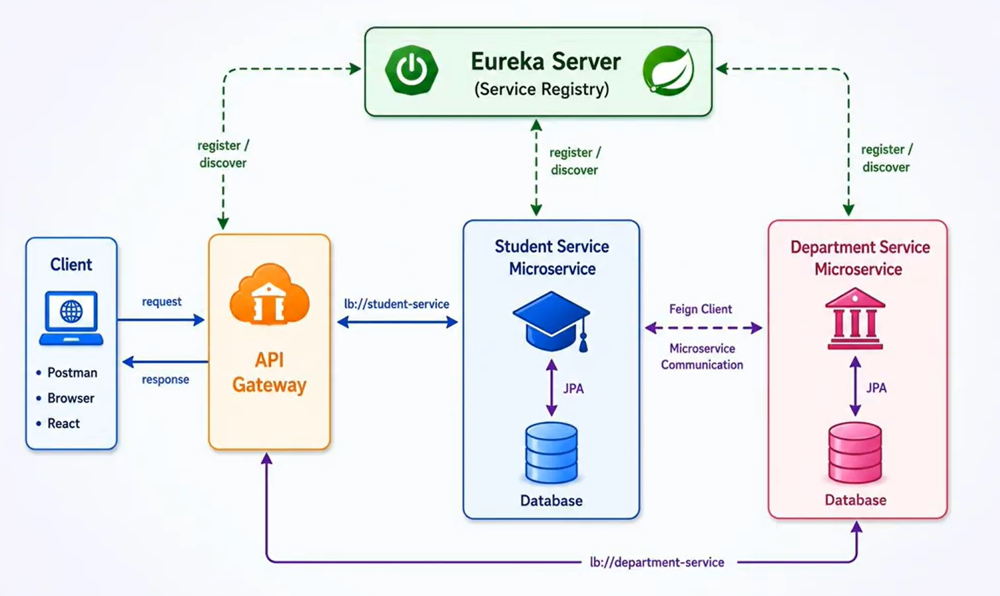

# Spring Boot Microservices Architecture

This repository focuses on the core concepts and operational flow of a distributed microservices architecture using Spring Cloud. 

## 🏗️ How the Architecture Works

This architectural pattern decouples a monolithic application into independent, specialized services. The system operates through the following workflow:

*   **Client Interaction:** External clients (such as Postman, a web browser, or a React frontend) initiate requests to the system[cite: 12].
*   **API Gateway (The Entry Point):** All incoming client requests are intercepted by the API Gateway[cite: 12]. It acts as a reverse proxy, resolving network locations and using load balancing protocols (e.g., `lb://student-service` or `lb://department-service`) to route traffic to the appropriate backend service[cite: 12].
*   **Service Registry (Eureka Server):** This acts as the central discovery directory[cite: 12]. Every microservice and the API Gateway registers its network location with the Eureka Server upon startup[cite: 12]. This allows components to dynamically discover and route traffic to one another without hardcoded IP addresses[cite: 12].
*   **Independent Microservices:** Individual domains (like the Student Service and Department Service) are isolated[cite: 12]. To ensure true decoupling, each microservice manages its own dedicated database via JPA[cite: 12].
*   **Inter-Service Communication:** When internal services need to exchange data (e.g., the Student Service requesting data from the Department Service), they bypass the API Gateway[cite: 12]. Instead, they communicate directly via a **Feign Client**, which handles the internal microservice-to-microservice requests[cite: 12].

---
*Developed by Abdullah Fahman*